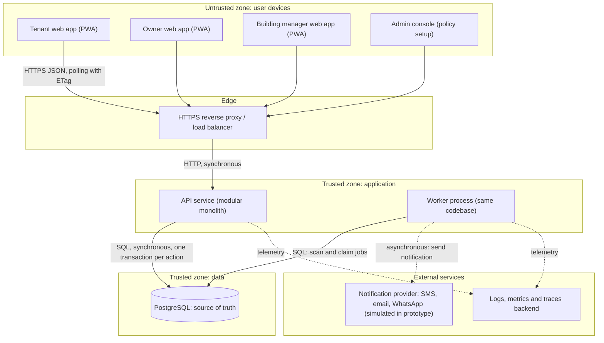
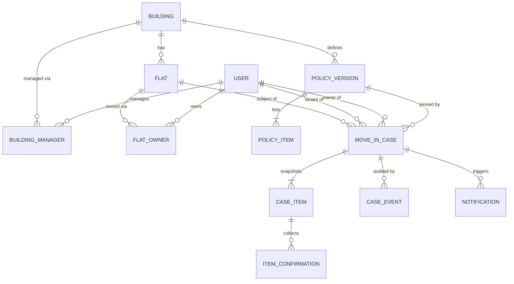

# MoveIn Clear — High-Level Design (HLD)

| | |
|---|---|
| Version | 0.1, draft for review |
| Date | 2026-11-01 |
| Companion document | `LLD.md` (low-level design) |
| Source | "MoveIn Clear" concept sheet (MAL 4, PropTech) |
| Stage | Hackathon prototype, designed so it can grow into a pilot |

> Everything here is a proposal. No private company architecture is assumed or claimed. Numbers are estimates built from assumptions that are written down in Section 2 and Section 3, so you can change an input and redo the arithmetic.

---

## Reading guide and key terms

Terms are explained once here and again in plain words where they first matter.

| Term | Meaning in this document |
|---|---|
| **Policy** | A building's list of items that must be completed before move-in (for example owner consent, agreement, society NOC, deposit). |
| **Policy version** | A numbered, immutable snapshot of a policy. Editing a policy means publishing a new version. |
| **Mandatory item** | A policy item that must be APPROVED or DONE before the case can become READY FOR MOVE-IN. |
| **Readiness gate** | The server-side check that blocks key handover until every mandatory item is complete. |
| **Source of truth** | The one place whose data wins any disagreement. Here: the PostgreSQL database behind the server. |
| **Idempotency key (request ID)** | A unique ID the client attaches to a write. If the same request is sent twice (for example after a network drop), the server performs it once and returns the same answer. |
| **Optimistic concurrency (version check)** | Every record carries a version number. A write says "I based this on version N"; if the record is now at N+1 the server refuses with HTTP 409 instead of silently overwriting. |
| **ETag** | An HTTP header carrying a version fingerprint. A client that sends it back gets `304 Not Modified` (no body) if nothing changed, which makes polling cheap. |
| **RBAC** | Role-based access control: what you may do depends on your role. Here roles are per case, not global. |
| **IDOR** | Insecure direct object reference: reading or changing someone else's record by guessing its ID. |
| **Transactional outbox** | Notifications are written to the database in the same transaction as the change that caused them. A worker sends them later, so none are lost or sent for changes that rolled back. |
| **Dead-letter** | Where a job or message goes after all retries fail, so it can be inspected instead of retried forever. |
| **Circuit breaker** | A guard that stops calling a failing dependency for a short time so failures do not pile up. |
| **Backpressure** | Deliberately slowing or rejecting new work (for example HTTP 429/503) when the system is saturated. |
| **Trust boundary** | A line across which data must be treated as untrusted and re-validated (for example browser to server). |
| **SLI / SLO** | Service level indicator (a measurement, such as "fraction of requests that succeed") and objective (the target for it). |
| **RPO / RTO** | Recovery point objective (maximum data loss measured in time) and recovery time objective (maximum time to restore service). |
| **PITR** | Point-in-time recovery: restoring the database to any moment using a base backup plus archived write-ahead logs. |
| **Modular monolith** | One deployable application with strict internal module boundaries, as opposed to many separately deployed services. |
| **PII** | Personally identifiable information (names, phone numbers, emails). |

---

## 1. Overview

### 1.1 Purpose

MoveIn Clear puts every step needed to move into a rented flat in one shared, traceable **move-in case**. Today the steps (owner consent, agreement completion, society or building NOC where required, deposit confirmation, other building-specific tasks) are tracked by different people. A tenant cannot see what is pending, who must act next, or why the move-in is blocked.

The system's central promise is a hard business rule:

> **No mandatory approval, no key handover.** The server moves a case to READY FOR MOVE-IN only when every mandatory item in the building's active policy is approved or completed.

### 1.2 Problem restated

Build a web platform where (a) a tenant opens a case for a flat, (b) the server loads that building's active policy and creates the checklist, (c) each authorised role completes only its own items, (d) the server enforces the gate, and (e) the owner records key handover to close the case as MOVED IN. One workflow engine must serve buildings with different rules, with no separate app per building. The server database is the source of truth; decisions and reopen actions are audited; retries and stale updates must be safe.

### 1.3 Users and key user journeys

| Role | Who | What they do |
|---|---|---|
| **Tenant** | Person moving in | Opens the case, completes assigned tasks (for example agreement confirmation), tracks blockers, nudges slow parties. |
| **Owner** | Flat owner of record | Gives consent, confirms agreement and deposit milestones, records key handover. |
| **Building / society manager** | Staff of the building | Acts on the NOC item only when the active policy requires one. |
| **Platform admin** | Hackathon organiser / operator | Seeds buildings and publishes policies. Not part of the move-in journey. |

Roles are **contextual**: a person is the tenant of one case and may be the owner in another.

Key journeys:

- **J1 Start.** Tenant picks a flat, sees the checklist that will apply, saves a draft, submits.
- **J2 Act.** Each role opens "my tasks", acts on its item (approve, reject, confirm), and sees the effect immediately in the shared case view.
- **J3 Blocked.** An item is rejected or overdue. The case goes ON HOLD, shows the reason and the next responsible role; the problem is fixed and the case resumes.
- **J4 Close.** All mandatory items complete, the case becomes READY FOR MOVE-IN, and the owner records key handover. The case is MOVED IN.
- **J5 Recover.** The tenant's connection drops mid-submit. On return, the draft is intact, the retry does not create a duplicate, and if the building's policy changed meanwhile the tenant is shown the new checklist before submitting.

### 1.4 Scope

| In scope (from the concept sheet) | Out of scope |
|---|---|
| Move-in cases, configurable mandatory checklist, role-based actions, blocker tracker, reminders, audit timeline, safe retry | Payments, e-signatures, legal or document verification, live police or society integrations, maps |
| Society-tower and standalone-building policies | Document or file uploads (added assumption A15) |
| Simulated external steps and sample data | Any claim of real-world verification |

### 1.5 Open questions and the default used

You asked for up to eight clarifying questions before the final files. The concept sheet answers most of what matters, so these files proceed on the defaults below. Each is flagged where it affects the design. Please confirm or correct them.

| # | Question | Default assumed |
|---|---|---|
| Q1 | Who authors and changes building policies, and may a change affect cases already in progress? | Platform admin publishes versions; in-progress cases stay **pinned** to the version they started with (A3). |
| Q2 | How is a flat linked to its owner? | Seeded for the prototype (`flat_owners`); an invite flow comes later (A4). |
| Q3 | Is "Agreement completion" done by tenant and owner each confirming? | Yes, dual confirmation by two different people (A5). |
| Q4 | What are the deadlines (SLAs) per item? | Illustrative defaults: consent 72 h, agreement 120 h, NOC 168 h, deposit 120 h (A7). |
| Q5 | Can a completed item be reopened, and by whom? | The item's responsible role or a platform admin, with a reason, until MOVED IN (A11). |
| Q6 | Expected pilot and growth size? | Three scenarios in Section 3: 100, 3,000, and 30,000 new cases per month (A8). |
| Q7 | Which reminder channels? | In-app plus simulated SMS/email/WhatsApp (A10). |
| Q8 | Data retention and privacy obligations? | Keep case and audit data 3 years after closure; treat India's DPDP Act, 2023 as likely applicable and confirm with counsel (A12). |

---

## 2. Requirements

### 2.1 Requirements given (G) — taken from the concept sheet

| ID | Requirement |
|---|---|
| G1 | A tenant opens a move-in case for a flat in a Mumbai rental building. |
| G2 | The system loads that building's active policy. One workflow engine serves different building rules; no per-building apps. |
| G3 | Items and their roles: Owner consent (owner), Agreement completion (tenant and owner), Society NOC (building manager, only when the policy requires it), Deposit confirmation (owner). Other building-specific tasks are possible. |
| G4 | Only the authorised role may decide its assigned item. |
| G5 | The server moves a case to READY FOR MOVE-IN only when every mandatory item in the active policy is approved or completed. |
| G6 | The owner records key handover; the case then closes as MOVED IN. |
| G7 | Lifecycle: DRAFT, IN PROGRESS, ON HOLD, READY FOR MOVE-IN, MOVED IN. ON HOLD means a mandatory item is rejected or overdue, and the reason and next responsible role are shown. |
| G8 | A live blocker tracker shows progress ("2 of 4"), the pending item, the responsible role, and the latest status. |
| G9 | Reminders. |
| G10 | Audit timeline; decisions and reopen actions are audited. |
| G11 | The server database is the source of truth; all roles see the same case status. |
| G12 | Recovery: keep an interrupted draft; retry with the same request ID; re-check the latest policy version on the server; a stale update is refreshed, not silently overwritten. |
| G13 | Success: no premature key handover, no unauthorised decision, no duplicate on retry, consistent status across roles. |
| G14 | Constraint: hackathon prototype; external steps and sample data are simulated; no live integrations or real document verification. |

### 2.2 Non-functional requirements (N) — targets I propose

| ID | Area | Target | Why |
|---|---|---|---|
| N1 | Availability | Prototype/pilot 99.5% per month (about 3.6 h downtime budget); production stage 99.9% (about 43 min) | Move-in is time-bound but not life-critical; cost of high availability should match stage. |
| N2 | Latency | p95 ≤ 300 ms reads and ≤ 500 ms writes at the API, p99 ≤ 1 s, at expected peak (about 8 requests/s) | Interactive checklist actions should feel instant (G8). |
| N3 | Durability and RPO | No acknowledged write lost on single-node failure; RPO ≤ 5 min (production), ≤ 24 h (prototype) | Decisions are audited records (G10). |
| N4 | RTO | ≤ 1 h (production), ≤ 4 h (prototype) | Matches N1. |
| N5 | Consistency | Strong consistency per case. After a write commits, every read returns the new state. Other roles see it within one polling interval (≤ 15 s) | G11. |
| N6 | Safety invariants | Zero MOVED IN cases with an incomplete mandatory item; zero accepted decisions from an unauthorised role; zero duplicate cases or events from retries | G5, G13. Enforced in code and database constraints, checked by monitors. |
| N7 | Security and privacy | TLS everywhere, encryption at rest, least privilege, append-only audit, PII minimisation | G4, G10. |
| N8 | Recoverability | Drafts survive client crash and reload; every mutation is replay-safe | G12. |
| N9 | Auditability | Every state change has actor, role, time, request ID | G10. |
| N10 | Reminder timeliness | 95% of reminders dispatched within 5 min of their scheduled time | G9. |
| N11 | Configurability | A new building policy is configuration only, no code deploy | G2. |

### 2.3 Assumptions I introduced (A)

| ID | Assumption |
|---|---|
| A1 | Technology preference was not given. Proposed: TypeScript end to end (React PWA, Node API), PostgreSQL. Alternatives are in Section 11. |
| A2 | Roles are per case. A global `PLATFORM_ADMIN` flag exists only to seed buildings and policies. |
| A3 | A case is pinned to a policy version when submitted. Draft cases always adopt the latest active version at submit time, after the tenant sees it. |
| A4 | Flat-to-owner and building-to-manager bindings are seeded and not verified (verification is out of scope, G14). One primary owner per flat. |
| A5 | Item decision modes: `APPROVAL` (a decider approves or rejects), `CONFIRMATION` (the role marks done), `DUAL_CONFIRMATION` (each required role confirms, by different people). |
| A6 | A terminal `CANCELLED` status is added (not in the concept sheet) so abandoned cases release the flat. |
| A7 | Item deadlines are illustrative: consent 72 h, agreement 120 h, NOC 168 h, deposit 120 h from when the item opens. |
| A8 | Scale scenarios in Section 3 (low, expected, high). Real numbers are unknown. |
| A9 | Login by phone OTP. In the prototype the OTP provider is simulated. |
| A10 | Notifications: in-app, plus simulated SMS/email/WhatsApp behind an adapter. |
| A11 | Reopen is allowed by the item's responsible role or a platform admin, with a mandatory reason, until MOVED IN. |
| A12 | Case and audit data retained 3 years after a case reaches a terminal state; notifications 90 days; idempotency keys 7 days. |
| A13 | One open (non-terminal) case per flat at a time. |
| A14 | Hosting in an India region; single region in all stages shown. |
| A15 | No file uploads. Evidence documents, if any, are referenced by free-text notes only. |
| A16 | `PENDING` means "open or blocked, nobody has acted"; `WAITING` means "submitted or partly confirmed, a decision or confirmation is awaited". The concept sheet shows both labels without defining them. |

---

## 3. Capacity estimates

Real traffic is unknown, so three scenarios are used. All formulas are shown so inputs can be changed.

**Inputs (assumptions A8):**
- Average case life from DRAFT to MOVED IN: 30 days.
- Participants per case: 3 (tenant, owner, manager/other), treated as distinct for a conservative count.
- Daily active users (DAU): 25% of participants on active cases.
- Requests per DAU per day: 30 = about 10 content reads + 19 cheap conditional polls (`304`) + about 1 write.
- Writes per case over its life: 25 (create, edits, submit, about 8 item actions, nudges, handover, logins).
- Audit events per case: 40. Peak-to-average factor: 10 (covers evening and lunch-hour concentration and bursts).

| Quantity | Formula | Low (pilot) | Expected (city rollout) | High (growth) |
|---|---|---:|---:|---:|
| Buildings onboarded | input | 20 | 500 | 5,000 |
| New cases per month | input | 100 | 3,000 | 30,000 |
| New cases per day | month ÷ 30 | 3.3 | 100 | 1,000 |
| Active cases | per day × 30 | 100 | 3,000 | 30,000 |
| Participants on active cases | active × 3 | 300 | 9,000 | 90,000 |
| Daily active users | participants × 25% | 75 | 2,250 | 22,500 |
| Requests per day | DAU × 30 | 2,250 | 67,500 | 675,000 |
| Average requests/s | per day ÷ 86,400 | 0.03 | 0.78 | 7.8 |
| **Peak requests/s** | average × 10 | **0.26** | **7.8** | **78** |
| Writes per day | cases/day × 25 | 83 | 2,500 | 25,000 |
| Peak writes/s | writes/day ÷ 86,400 × 10 | 0.01 | 0.29 | 2.9 |
| Write share of requests | writes ÷ requests | 3.7% | 3.7% | 3.7% |
| Read : write ratio | | about 26 : 1 | about 26 : 1 | about 26 : 1 |
| Audit events per day | cases/day × 40 | 133 | 4,000 | 40,000 |

**Storage.** Estimated durable footprint per case, including indexes and short-lived notification rows:

| Part | Calculation | Size |
|---|---|---:|
| Case row | 1 row | 1 KB |
| Case items and confirmations | 6 items × 0.6 KB | 3.6 KB |
| Audit events | 40 × 0.5 KB | 20 KB |
| Notifications | 12 × 0.5 KB | 6 KB |
| Subtotal | | about 30 KB |
| Indexes and overhead | about 1× the table data | about 30 KB |
| **Per case** | | **about 60 KB** |

| | Low | Expected | High |
|---|---:|---:|---:|
| Data per day (cases/day × 60 KB) | 0.2 MB | 6 MB | 60 MB |
| Cases per year (month × 12) | 1,200 | 36,000 | 360,000 |
| **Storage after 1 year** (cases × 60 KB) | **72 MB** | **2.16 GB** | **21.6 GB** |
| **Storage after 3 years** | **216 MB** | **6.5 GB** | **65 GB** |
| Provision (3× for WAL, bloat, backups) | under 1 GB | about 20 GB | about 200 GB |

Reference data (users, buildings, flats) is below 0.5 GB even in the high case (for example 5,000 buildings × 100 flats × 0.3 KB ≈ 150 MB; 90,000 users × 1 KB ≈ 90 MB).

**Bandwidth.** Per DAU per day: 10 reads × 6 KB + 19 polls × 0.5 KB + 1 write × 4 KB ≈ 74 KB.

| | Low | Expected | High |
|---|---:|---:|---:|
| Traffic per day (DAU × 74 KB) | 5.5 MB | 167 MB | 1.67 GB |
| Average throughput | 0.06 KB/s | 1.9 KB/s | 19 KB/s |
| Peak throughput (× 10) | 0.6 KB/s | 19 KB/s (0.15 Mbps) | 193 KB/s (1.5 Mbps) |

**Media or file storage:** none (A15).

**What this tells us.** Even the high scenario peaks at roughly 78 requests/s and 65 GB after three years. Those loads are well within what a single modest managed PostgreSQL instance typically handles; this should be confirmed with the load test in `LLD.md` Section 9. The design therefore favours simplicity and correctness over distributed infrastructure.

---

## 4. Architecture

### 4.1 Components and responsibilities

| Component | Responsibility |
|---|---|
| **Web client (React PWA, mobile first)** | Role-aware screens: case view with blocker tracker, "my tasks", policy preview, audit timeline. Autosaves drafts. Generates one idempotency key per user intent and keeps it until a final answer arrives. Polls with ETags. Never decides anything: it only displays what the server says is allowed. |
| **HTTPS reverse proxy / load balancer** | TLS termination, coarse rate limiting, request size limits, routing to API instances, health checks. |
| **API service (modular monolith)** | Modules: Auth and Sessions; Directory (buildings, flats, owner/manager bindings, role resolution); Policy; Case and Workflow Engine (state machine, dependency opening, readiness gate); Audit; Notification enqueue; Query (case view, tasks, timeline). All business rules live here. |
| **Worker process (same codebase, separate process)** | Overdue sweeper, reminder scanner, notification dispatcher, retention purge, invariant checker. Reads work from PostgreSQL; never from the client. |
| **PostgreSQL** | Single source of truth: relational data, append-only audit events, notification outbox, idempotency records, sessions. |
| **Notification provider (external)** | Delivers SMS, email, WhatsApp. Simulated in the prototype (G14). |
| **Observability backend (external)** | Stores logs, metrics, traces. |

**Why a modular monolith with only PostgreSQL?** The expected peak is about 8 requests/s (Section 3), the team is small, and the hardest requirements (G4, G5, G11, G12) are about transactional correctness. One database transaction can lock a case, check the gate, write the audit event and enqueue a notification atomically. Splitting this across services, a cache, and a message broker would add failure modes without a demonstrated need.

### 4.2 Architecture diagram



**Synchronous paths:** client → proxy → API → PostgreSQL for every user action and read.
**Asynchronous paths:** worker → notification provider; worker → PostgreSQL scans (overdue, reminders). The API never calls the notification provider directly, so provider outages cannot fail a user action.

**Trust boundaries**

| Boundary | Between | Controls |
|---|---|---|
| TB1 | Internet / user devices ↔ edge | TLS, rate limits, size limits, authentication, server re-validation of everything the client sends (including role claims, which the server ignores). |
| TB2 | Edge ↔ application | Private network, only the proxy is exposed. |
| TB3 | Application ↔ database | Dedicated least-privilege DB role; audit table is insert-only for the app role. |
| TB4 | Application/worker ↔ external providers | Outbound-only, timeouts, circuit breaker, no PII beyond what the message needs. |

### 4.3 Main request and data flows

**Flow A — Open and submit a case (G1, G2, G12)**
1. Tenant selects a flat. Client calls `GET /v1/flats/{flatId}/policy` and shows the checklist that would apply, including which roles act on each item.
2. Client calls `POST /v1/cases` with an idempotency key. The server inserts a DRAFT case and a `CASE_CREATED` event in one transaction. If the same flat already has an open case, the server returns 409 (with the existing draft's ID if it is the caller's own, so the client resumes it).
3. Tenant edits the draft (planned date, notes). Each `PATCH` carries `If-Match` with the case version.
4. Tenant submits: `POST /v1/cases/{id}/submit` with the policy version the tenant saw. In one transaction the server locks the case, re-reads the building's *current* active policy, and compares. If different, it answers 409 `POLICY_CHANGED` with the new checklist and changes nothing. If equal, it copies the policy items into case items (a snapshot), opens the items that have no unmet dependency, sets IN PROGRESS, writes events, and enqueues notifications to the owner (and others as items open).

**Flow B — A role acts on its item (G3, G4, G5, G10)**
1. A role opens "my tasks" (`GET /v1/me/tasks`) and the case.
2. The client posts an action (`APPROVE`, `REJECT`, `CONFIRM`, `RESUBMIT`, `REOPEN`) with `If-Match` set to the item's version and a new idempotency key.
3. The server, in one transaction: locks the case row, checks the caller is a participant, compares versions, checks the action is legal for the item's mode and status, checks the caller's role (derived from the database, not the request) is allowed, applies the change, opens any newly unblocked items, recomputes the case status, writes the audit event, and enqueues notifications.
4. The response contains the updated case view. Other roles see it on their next poll.

**Flow C — Key handover through the gate (G5, G6)**
1. When the case is READY FOR MOVE-IN, the owner's UI offers "Record key handover". Otherwise the UI shows why it is blocked.
2. `POST /v1/cases/{id}/key-handover` re-checks, inside the transaction and straight from the item rows, that every mandatory item is APPROVED or DONE. The stored status is not trusted. Failure returns 409 `GATE_NOT_SATISFIED`.
3. On success the case becomes MOVED IN and a `KEY_HANDOVER_RECORDED` event is written.

**Flow D — Retry and stale update (G12)**
1. A client whose response was lost resends the same request with the same idempotency key. The server finds the stored result and returns it (header `Idempotent-Replayed: true`). Nothing is applied twice.
2. A client acting on an outdated view sends an old version. The server answers 409 `STALE_VERSION` with the latest case snapshot. The UI refreshes and shows what changed; the user re-confirms. Nothing is overwritten silently.

**Flow E — Overdue and reminders (G7, G9)**
1. Every minute the worker (one instance wins an advisory lock) finds items past `due_at` and marks them overdue inside a per-case transaction. A mandatory overdue item moves the case to ON HOLD with reason `OVERDUE` and the next responsible role.
2. The worker also schedules a reminder before the deadline and repeated reminders while overdue. Reminders are rows in the outbox; a dispatcher sends them with retries and backoff, and moves them to dead-letter after repeated failure.

---

## 5. Interfaces

All endpoints are REST/JSON under `/v1`. Authentication is `Authorization: Bearer <session token>` unless noted. Every `POST`, `PATCH` requires `Idempotency-Key` (UUID). Errors use one envelope: `{"error": {"code", "message", "requestId", "details"}}`. Full contracts, validation and error codes are in `LLD.md` Section 3.

### 5.1 API list

| Method and path | Purpose | Who may call | Idempotency / concurrency | Common errors |
|---|---|---|---|---|
| `POST /v1/auth/otp/request` | Send login OTP (simulated in prototype) | Anyone | Rate limited; safe to repeat | 429 |
| `POST /v1/auth/otp/verify` | Exchange OTP for session token | Anyone | One-time code | 401, 429 |
| `GET /v1/me` | Current user | Any user | n/a | 401 |
| `GET /v1/buildings`, `GET /v1/buildings/{id}/flats` | Find building and flat | Any user | n/a | 401 |
| `GET /v1/flats/{flatId}/policy` | Preview active checklist | Any user | n/a | 404 |
| `POST /v1/cases` | Create DRAFT case | Any user (becomes TENANT) | Key required | 409 `FLAT_HAS_ACTIVE_CASE`, 422 |
| `GET /v1/cases/{id}` | Case view with blocker tracker | Case participants | ETag / `If-None-Match` | 404 (also for non-participants) |
| `PATCH /v1/cases/{id}` | Edit draft fields | Tenant | Key + `If-Match` (case version) | 409 `STALE_VERSION` |
| `POST /v1/cases/{id}/submit` | DRAFT → IN PROGRESS, snapshot policy | Tenant | Key + `If-Match` | 409 `POLICY_CHANGED`, `INVALID_TRANSITION` |
| `POST /v1/cases/{id}/items/{itemKey}/actions` | Approve, reject, confirm, resubmit, reopen | Per item rules | Key + `If-Match` (item version) | 403 `FORBIDDEN_ROLE`, 409 `STALE_VERSION`, `INVALID_TRANSITION`, `DEPENDENCY_NOT_MET` |
| `POST /v1/cases/{id}/items/{itemKey}/nudge` | Remind responsible roles | Tenant | Key; max once per item per 24 h | 429 |
| `POST /v1/cases/{id}/key-handover` | Record key handover | Owner | Key + `If-Match` (case version) | 409 `GATE_NOT_SATISFIED` |
| `POST /v1/cases/{id}/cancel` | Cancel an open case | Tenant (or admin) | Key + `If-Match` | 409 `INVALID_TRANSITION` |
| `GET /v1/cases/{id}/events` | Audit timeline (cursor paging) | Case participants | n/a | 404 |
| `GET /v1/me/tasks` | Items awaiting me across cases | Any user | ETag | n/a |
| `GET /v1/me/notifications`, `POST /v1/me/notifications/{id}/read` | In-app inbox | Any user | Mark-read is idempotent | 404 |
| `POST /v1/admin/buildings/{id}/policies` | Create draft policy version | Platform admin | Key | 422 |
| `POST /v1/admin/policies/{versionId}/publish` | Make a version ACTIVE | Platform admin | Key | 409 `INVALID_TRANSITION` |

### 5.2 Example: create a case

```http
POST /v1/cases
Authorization: Bearer <token>
Idempotency-Key: 6f1c9b7e-3a52-4c1d-9e0b-2d4a6c8e0f13
Content-Type: application/json

{ "flatId": "2b9e6a10-3c4d-4e5f-8a7b-9c0d1e2f3a4b", "plannedMoveInDate": "2026-12-01" }
```

```http
HTTP/1.1 201 Created
ETag: "c1"

{
  "id": "7c1d2e54-8a0b-4f7e-9d3a-5b6c1e2f3a4b",
  "status": "DRAFT",
  "version": 1,
  "flatId": "2b9e6a10-3c4d-4e5f-8a7b-9c0d1e2f3a4b",
  "buildingId": "5d8f1a22-6b7c-4d8e-9f0a-1b2c3d4e5f60",
  "plannedMoveInDate": "2026-12-01",
  "policyPreview": {
    "policyVersionId": "9a3c5e71-2d4f-4b6a-8c0e-1f3a5b7c9d2e",
    "items": [
      { "itemKey": "OWNER_CONSENT", "mandatory": true, "responsibleRoles": ["OWNER"] },
      { "itemKey": "AGREEMENT_COMPLETION", "mandatory": true, "responsibleRoles": ["TENANT", "OWNER"] },
      { "itemKey": "SOCIETY_NOC", "mandatory": true, "responsibleRoles": ["BUILDING_MANAGER"] },
      { "itemKey": "DEPOSIT_CONFIRMATION", "mandatory": true, "responsibleRoles": ["OWNER"] }
    ]
  }
}
```

Errors: `401 UNAUTHENTICATED`, `404 NOT_FOUND` (flat), `409 FLAT_HAS_ACTIVE_CASE` (details include `existingCaseId` if it is the caller's own draft), `422 VALIDATION_FAILED`, `429 RATE_LIMITED`.
Idempotency: resending with the same key and body returns the same `201` body with `Idempotent-Replayed: true`. Same key with a different body returns `422 IDEMPOTENCY_KEY_REUSED`.

### 5.3 Example: building manager approves the NOC

```http
POST /v1/cases/7c1d2e54-8a0b-4f7e-9d3a-5b6c1e2f3a4b/items/SOCIETY_NOC/actions
Idempotency-Key: 0d9b2c47-5e1a-4f36-8b7d-3c2a1e0f9d85
If-Match: "i3"

{ "action": "APPROVE", "note": "NOC issued by society office." }
```

```http
HTTP/1.1 200 OK
{ "caseId": "7c1d2e54-8a0b-4f7e-9d3a-5b6c1e2f3a4b",
  "caseStatus": "IN_PROGRESS", "caseVersion": 9,
  "item": { "itemKey": "SOCIETY_NOC", "status": "APPROVED", "version": 4 },
  "readiness": { "completeMandatory": 3, "totalMandatory": 4 } }
```

Errors: `403 FORBIDDEN_ROLE` (caller is not a manager of this building, or this item does not list the manager), `409 STALE_VERSION` (body includes the latest case), `409 INVALID_TRANSITION`, `409 DEPENDENCY_NOT_MET`, `422 VALIDATION_FAILED` (a note is required for `REJECT` and `REOPEN`).

### 5.4 Internal domain events

There is no external message broker. Domain events are rows in the append-only `case_events` table (the audit trail) and drive notifications via the outbox.

| Event | Raised when | Typical consumers |
|---|---|---|
| `CASE_CREATED`, `DRAFT_UPDATED`, `CASE_SUBMITTED`, `CASE_CANCELLED` | Case lifecycle | Audit, owner notification |
| `ITEM_OPENED`, `ITEM_APPROVED`, `ITEM_REJECTED`, `ITEM_CONFIRMED`, `ITEM_RESUBMITTED`, `ITEM_REOPENED`, `ITEM_OVERDUE` | Item changes | Audit, notifications |
| `STATUS_CHANGED` | Case status moves | Audit, notifications |
| `KEY_HANDOVER_RECORDED` | Owner closes the case | Audit, notifications |
| `NUDGE_SENT` | Tenant nudges | Audit, notification |

---

## 6. Data architecture

### 6.1 Data stores

| Store | What it holds | Why |
|---|---|---|
| **PostgreSQL (primary)** | Users, buildings, flats, ownership and manager bindings, policy versions and items, cases, case items, confirmations, audit events, notifications (outbox), idempotency keys, sessions, OTP challenges | Strong transactions, row locks, constraints and partial unique indexes enforce G4, G5, G12, G13 directly (N6). Source of truth (G11). |
| **Browser local storage (client)** | Unsent draft form values and the pending idempotency key | Lets a draft survive a crash or lost connection (G12). Never trusted by the server. |
| **In-process memory (API)** | Immutable policy versions (small LRU) | Policy versions never change once published, so caching is safe. Not used for gate or submit decisions. |

Deliberately **not** used in the MVP: Redis, a message broker, a search engine, object storage, an analytics warehouse. Reasons are in Section 11. Queues are PostgreSQL tables claimed with `FOR UPDATE SKIP LOCKED` (a lock option that lets several workers take different rows without blocking each other).

### 6.2 Main entities and relationships



### 6.3 Ownership and consistency choices

| Data | Owner module | Consistency choice |
|---|---|---|
| Case, items, confirmations, status | Case and Workflow Engine | Mutated only inside a transaction that first locks the case row, so all changes to one case are serialised. Case status is stored (for fast queries) but always recomputed in the same transaction from item rows. |
| Audit events | Audit | Append-only, written in the same transaction as the change. A change without its event, or an event without its change, cannot exist. |
| Policy versions | Policy | Immutable once ACTIVE. Cases copy (snapshot) items at submit, so later policy edits cannot change a running case. |
| Notifications | Notification | Written in the same transaction as the cause (outbox). Delivery is at-least-once; dedupe keys prevent duplicate rows. |
| Idempotency keys | Idempotency middleware | Written in the same transaction as the business change, so "key recorded" and "change applied" are all-or-nothing. |
| Users, bindings | Directory | Low write rate; seeded in the prototype. |

Reads in the MVP go to the primary database, which gives read-your-writes (N5). A read replica, if added later, is used only for reports and old timeline pages where small lag is acceptable.

### 6.4 Caching, search, analytics, queues

- **Caching:** HTTP ETags on case and task reads (cheap polling). Immutable policy versions cached in process. No distributed cache.
- **Search:** building and flat lookup uses PostgreSQL trigram indexes (`pg_trgm`), adequate for thousands of buildings.
- **Analytics:** SQL views over the primary for demo metrics (average time to READY, most common blocker). A replica or warehouse is a later-stage option.
- **Queues:** the `notifications` table is the outbox/queue; scans for overdue items use partial indexes.

---

## 7. Scaling strategy

Load is small (Section 3), so scaling is a ladder to climb only when measurements say so.

| Step | Trigger (measured) | Action |
|---|---|---|
| 0. Start | Prototype | One API instance, one worker, one PostgreSQL instance. |
| 1. Stateless API replicas | CPU > 60% sustained, or need for zero-downtime deploys | Run 2+ API instances behind the proxy. The API keeps no session state (sessions are in the database), so any instance can serve any request. |
| 2. Connection pooling | DB connections > 70% of limit | Put a pooler (PgBouncer) in front of PostgreSQL. |
| 3. Reduce polling cost | Poll traffic dominates | ETag/304 already in place; lengthen interval when tab is hidden; later add Server-Sent Events (one-way server push) for case updates. |
| 4. Read replica | Reports or timelines slow the primary | Route reports and old timeline pages to a replica; keep decisions and gate checks on the primary. |
| 5. Partition large tables | `case_events` above roughly 100 million rows | Range-partition by `created_at`; keep lookups by `(case_id, seq)`. |
| 6. Sharding | Not expected | Even the high scenario (65 GB in 3 years, 78 requests/s peak) does not call for it. If needed later, the natural shard key is `building_id`, because a case never spans buildings. |

**Load balancing and statelessness:** round-robin at the proxy; health checks on `/readyz`. **Caching:** see 6.4. **Replication:** a standby for failover in the production stage (Section 8). **Queues and backpressure:** the outbox decouples sending from user actions. Workers claim small batches and respect provider rate limits; the API sheds load with `429`/`503` plus `Retry-After` when its concurrency cap is reached, and the client backs off with jitter.

**Likely bottlenecks and how to detect them**

| Bottleneck | Signal |
|---|---|
| DB connection exhaustion | `db_pool_in_use` near max, rising request queue time |
| Lock contention on one case | p99 of item-action latency; `lock_timeout` errors |
| Polling storms | requests/s by route; share of 304s |
| Worker backlog | `notification_oldest_pending_age_seconds` |
| Provider throttling | rising send failures, circuit breaker opens |
| Disk growth | storage forecast against Section 3 |

---

## 8. Reliability and recovery

| Failure | Behaviour |
|---|---|
| API instance crash mid-request | The transaction rolls back (nothing half-applied). The client retries with the same idempotency key; the result is applied once. |
| Lost response after commit | Retry returns the stored response (replay), not a second action (G12, G13). |
| Database slow or briefly unavailable | Statement timeout 3 s and lock timeout 2 s; API returns `503` with `Retry-After`. The client keeps the draft locally and retries. |
| Notification provider down | Circuit breaker opens after 5 consecutive failures; messages wait in the outbox; in-app notifications still work; user actions are unaffected (graceful degradation). |
| Duplicate messages | Outbox rows have a unique `dedupe_key`; provider calls carry the notification ID as the provider-side idempotency key where supported; reminders tolerate at-least-once delivery. |
| Worker crash | Jobs are re-claimable; the sweeper re-checks state under the case lock before acting, so replays are harmless. |
| Policy changed during a draft | Submit returns `POLICY_CHANGED` with the new checklist; the tenant reviews and resubmits (G12). |
| Stale client update | `STALE_VERSION` plus latest snapshot (G12). |
| Clock differences | All deadlines use database time, not client or server clocks. |

**Timeouts and retries.** HTTP server 10 s overall; DB statements 3 s; provider calls 5 s. Automatic retries only for idempotent operations: outbox sends (5 attempts, exponential backoff from 30 s with jitter, then dead-letter) and client retries carrying the same key.

**Backup, restore, disaster recovery**

| | Prototype | Production stage |
|---|---|---|
| Backups | Daily logical dump, 7 days kept | Continuous WAL archiving plus daily base backup; PITR window 7 days |
| RPO | ≤ 24 h | ≤ 5 min |
| RTO | ≤ 4 h (restore from dump, redeploy) | ≤ 1 h (promote standby in another availability zone, or PITR restore) |
| Restore drill | Once before demo | Quarterly |

Idempotency keys and sessions are disposable; losing them in a restore only forces re-login and removes replay protection for retries of requests made right before the failure.

---

## 9. Security and privacy

| Topic | Approach |
|---|---|
| **Authentication** | Phone OTP (6 digits, 5-minute expiry, 5 attempts, stored only as a keyed hash). Session token: 256-bit random, stored as a hash, 30-day absolute and 7-day idle expiry, revocable. OTP provider simulated in the prototype. |
| **Authorization** | Role is derived on the server from database facts (is this user the case's tenant, the flat owner on the case, a manager of the case's building?) for every request. The client's claims about roles are ignored. A decision requires both a participant check and an item-level check that the role is listed as responsible (G4). Non-participants receive `404`, which also blocks IDOR probing. Managers see only submitted cases whose policy gives them an item (least privilege). |
| **Gate enforcement** | In the transition code and again in the handover transaction (Section 4.3, Flow C). Optional database trigger as defence in depth (`LLD.md` Section 8). |
| **Encryption** | TLS 1.2+ in transit; encryption at rest on database storage and backups. |
| **Secrets** | Environment variables from the host's secret store; never in the repository; separate secrets per environment; rotation procedure documented. |
| **Abuse prevention** | Rate limits on OTP, drafts, nudges and general API; request size cap; strict input validation; one open case per flat. |
| **Audit logging** | Case events are append-only (insert-only DB grant plus trigger). Security events (login failures, forbidden attempts) are logged and counted but not written to the case timeline, so outsiders cannot spam it. |
| **Data retention** | Case and audit data 3 years after terminal state (A12, to be confirmed with counsel); notifications 90 days; idempotency keys 7 days; OTP challenges 1 day after expiry. |
| **Sensitive data** | Stored PII is limited to name, phone, optional email. Phone numbers are masked for counterparts (for example `+91 98••••3210`) unless needed. No documents or government IDs are stored (A15). Logs mask phone numbers and never contain OTPs or tokens. Treat India's DPDP Act, 2023 as likely applicable: purpose limitation, consent, deletion on request subject to retention duties. Confirm with counsel before any real pilot. |

---

## 10. Operations

### 10.1 Observability

- **Logs:** structured JSON with `requestId`, route, status, duration, case ID; masked PII.
- **Metrics:** request rate/latency/errors by route; DB pool use; transitions by `from`→`to`; item actions by result; stale-version conflicts; idempotent replays; forbidden attempts; gate rejections; outbox depth and oldest age; dead-letter count; sweeper last-run time; `invariant_violations_total`.
- **Traces:** one trace per request spanning API, DB and outbound calls.

### 10.2 SLIs and SLOs

| SLI | SLO |
|---|---|
| Availability: non-5xx share of API requests | 99.5% monthly (prototype/pilot), 99.9% (production) |
| Read latency (p95) | ≤ 300 ms |
| Write latency (p95) | ≤ 500 ms |
| Reminder lag: time from scheduled to sent | 95% within 5 min |
| Safety invariants: MOVED IN with incomplete mandatory item; accepted decision by unauthorised role; duplicate case/event from retry | 0 (any occurrence is an incident) |

### 10.3 Alerts

Page: invariant violation > 0; 5xx rate > 2% for 5 min; p95 latency > 1 s for 10 min; backup failure. Warn: outbox oldest pending > 15 min; dead-letter > 0; sweeper silent > 5 min; DB connections > 80%; disk > 80%.

### 10.4 Deployment and rollback

- One container image, two process types (`api`, `worker`). Environments: local, staging, production.
- CI runs unit, integration (real PostgreSQL), contract and security-matrix tests before deploy.
- Database changes use *expand/contract*: first add new structures in a backward-compatible migration, deploy code that uses both, then remove old structures in a later release.
- Rolling deploy of API instances; the worker is replaced after the API (it holds an advisory lock, so two workers never double-run the sweeper).
- **Rollback:** redeploy the previous image. Because migrations are backward-compatible, the old code still works against the new schema. A destructive change (contract step) is never shipped in the same release as the code that stops needing the old structure.
- Health: `/healthz` (process up), `/readyz` (database reachable).

---

## 11. Trade-offs and alternatives

| Decision | Options considered | Recommendation | Why (tied to requirements) |
|---|---|---|---|
| Service shape | Microservices; modular monolith | **Modular monolith** | N6, G11: atomic transactions across case, audit and outbox. Peak load is about 8 requests/s (Section 3). Small team, hackathon time (G14). |
| Datastores | PostgreSQL only; + Redis; + Kafka | **PostgreSQL only** | Load is tiny; every extra system adds failure modes. Redis/Kafka revisited only if measurements demand it (Section 7). |
| Per-building behaviour | Hard-coded flows per building; policy as data; general workflow engine (for example BPMN/Temporal) | **Policy as data in PostgreSQL** with a small fixed state machine | G2, N11: new building = configuration. A general engine is more than the four-state lifecycle and four item modes need. |
| Policy changes vs running cases | Always use live policy; pin version per case | **Pin at submit**, re-check at submit | G12: stale/changed policies are surfaced explicitly; running cases do not shift under users. Trade-off: a mid-case policy change needs an explicit admin action (open question Q1). |
| Concurrency | Last write wins; pessimistic locks only; row lock + version check | **Case row lock + optimistic version check** | G12: "refreshed, not silently overwritten". Lock serialises writes per case; version check detects stale views. |
| Retry safety | Client dedupe only; server idempotency keys | **Server-side idempotency keys stored in the same transaction** | G13: no duplicates on retry, even across crashes. |
| Case status | Compute on read; store only; store and recompute on write | **Store, recomputed in the same transaction** | Fast queries and a single place that defines status (G7, G11). |
| Live updates | Polling with ETag; Server-Sent Events; WebSockets | **Polling with ETag** now, SSE later | N5 allows 15 s staleness; simplest to build and robust on mobile networks. |
| Authentication | Password; phone OTP; social login | **Phone OTP** | Phone is how Indian tenants and owners are reached; no passwords to store. Simulated in prototype (A9). |
| Technology | TypeScript + Node; Python (FastAPI); Java (Spring) | **TypeScript + Node + React** (A1) | One language across client and server for a small team. Any alternative works; the design does not depend on it. |
| Audit design | Mutable log; append-only table; event sourcing | **Append-only table written with the change** | G10 without the complexity of rebuilding state from events. |

---

## 12. Delivery plan

### 12.1 Phases

| Phase | Goal | Contents |
|---|---|---|
| **1. MVP (hackathon prototype)** | Prove the rule "no mandatory approval, no key handover" end to end | Seeded buildings, flats, users; two sample policies (society tower and standalone); case lifecycle and state machine; role-checked item actions; blocker tracker and "my tasks"; audit timeline; idempotency and version checks; overdue and reminders (simulated delivery); demo script showing premature handover is refused by the server. |
| **2. Pilot** | Real users in a few buildings | Real OTP and notification providers; owner invite and manager onboarding; policy admin UI; monitoring and alerts; backups with tested restore; privacy review; admin tool for dead-lettered notifications. |
| **3. Scale** | City-level rollout | Multiple API replicas and pooler; standby database and PITR; read replica for reports; SSE; co-owners and multi-unit owners; policy-change handling for in-flight cases; optional attachments (object storage); integrations with society systems if allowed. |

### 12.2 Risks, open questions, decisions to validate

| Item | Type | Mitigation or next step |
|---|---|---|
| Building requirements vary and are not confirmed | Risk | Treat sample policies as illustrative (concept sheet says so); confirm with organisers and at least one real building. |
| Owner and manager identity are asserted, not verified | Risk | Out of scope (G14); state clearly in the demo; add verification in Phase 2. |
| Reopening a dependency does not reopen already-complete dependents (for example NOC after agreement) | Decision | Default: no cascade; case returns to IN PROGRESS and a manager can reopen. Validate with a building manager (Q5). |
| Item deadlines (SLAs) are guesses | Decision | Make configurable per policy item; tune after pilot (Q4). |
| Policy changes while cases are in progress | Decision | Pin by default; define an admin "apply new policy" action before Phase 2 (Q1). |
| Retention period and DPDP obligations | Open question | Legal review before pilot (Q8). |
| Polling load grows with users | Risk | ETag now; SSE at step 3 of Section 7. |
| Single point of failure in prototype (one DB) | Accepted risk | Matches N1/N3 prototype targets; fixed in Phase 3. |
| Throughput assumptions (Section 3) | Validate | Load test early; replace scenario inputs with pilot data. |
